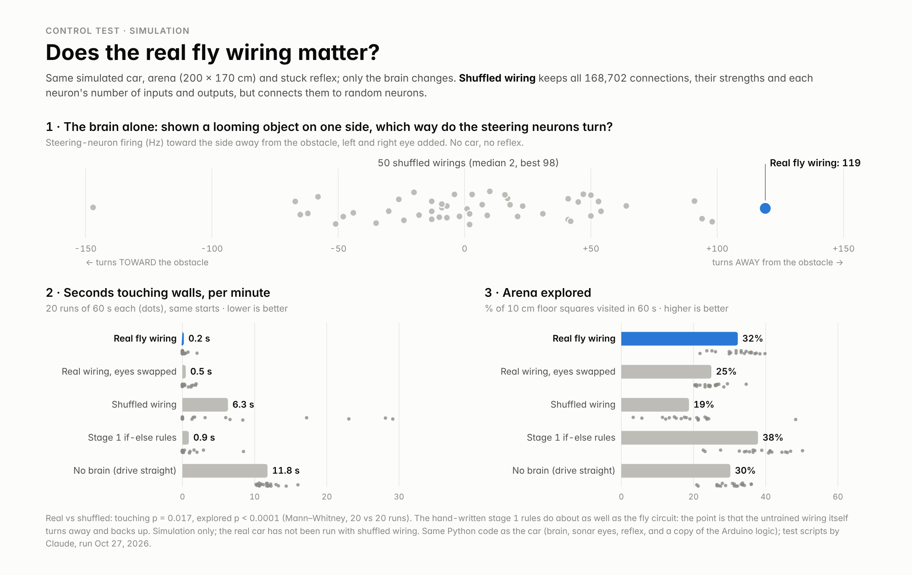

# Fly-brain car

A cardboard robot car steered by a simulated fruit-fly brain circuit: 2,282 neurons wired with the real synapse counts of the fruit fly *Drosophila* (FlyWire connectome). Nothing is trained. A sensor's view of approaching obstacles goes in as firing of the fly's looming-detector neurons; the firing of the fly's steering and backward-walking neurons comes out as wheel speeds.

Built in Uzbekistan, September–October 2026, by Islombek Turdiyev.

| Stage | Who drives | Sensor |
|---|---|---|
| 1 | if-else rules on the Arduino (no brain) | ultrasonic sensor on a servo, sweeping 5 directions |
| 2 | the fly circuit, on the laptop | the same sweeping ultrasonic sensor |
| 3 | the same fly circuit, unchanged | ESP32-CAM camera (image expansion = looming) |

In stages 2 and 3 a hand-written **stuck reflex** (`common/reflex.py`) backs the car up and turns it if the car stops moving. It is not part of the brain, and every moment it drives is logged (`reflex = 1` in the run logs).

## How it works

```
sensor ──► looming (how fast something gets closer) ──► eye neurons ──► 2,282-neuron fly circuit ──► steering / backing-up neurons ──► wheels
```

**The circuit** (`brain/locomotion/`): a part of the FlyWire v783 connectome of an adult female fruit fly.
- **Inputs:** 314 looming-detector neurons, LC4 and LPLC2, left eye (162) and right eye (152).
- **Outputs:** 12 descending neurons: DNa01 and DNa02 (steering), MDN, the "moonwalker" neurons (walking backward), DNp09 (walking forward) and the giant fiber DNp01 (escape). The car reads DNa01/DNa02 and MDN.
- **In between:** 1,956 neurons. Every neuron in the circuit is at most 3 synapses downstream of the eye neurons.
- **Connections:** 168,702 connections (1.33 million synapses), each weighted by its synapse count and signed by the predicted neurotransmitter of the sending neuron. `neurons.json` lists the FlyWire root IDs; `positions.csv` has each neuron's cell type.

**The neuron model** (`brain/flybrain.py`): leaky integrate-and-fire neurons with the constants of Shiu et al. 2024 (*Nature*): rest −52 mV, threshold −45 mV, membrane time constant 20 ms, synaptic time constant 5 ms, refractory period 2.2 ms, synaptic delay 1.8 ms, 0.275 mV per synapse. Their code uses Brian2; this is a NumPy version fast enough to run in real time on a laptop (0.1 ms steps; each control step simulates as much brain time as really passed, 50–100 ms).

**Sensor → eyes** (`common/brain_driver.py`, `stage2/stage2.py`, `stage3/vision.py`): the obstacle's angular size is computed from its distance; how fast that size grows becomes a Poisson firing rate (up to 250 Hz) on the eye neurons of that side. The 5 sonar directions are split into a left eye (far left, left, center) and a right eye (center, right, far right). In stage 3, optical-flow expansion in each half of the camera picture does the same job.

**Neurons → wheels:** turn = right steering rate − left steering rate (DNa01 + DNa02); forward speed = BASE − K_BACK × MDN rate. Wheel speeds follow over ~120 ms (motors have inertia). The constants are in `config.py`.

## Does the wiring matter? Control test (simulation)

`control_test/` runs the same brain, sonar and reflex code against a simulated car (`common/fake_robot.py`, a Python copy of `arduino/car/car.ino`) in a simulated 200 × 170 cm arena.



- **Brain alone** (`openloop.py`): shown a looming object on one side, the real wiring turns away from it (left eye → right turn 40 Hz, right eye → left turn 79 Hz; both eyes → no turn, MDN fires and the car backs up). Of 50 shuffled wirings (same synapses and strengths, same number of inputs and outputs per neuron, random partners), 7 turned away on both sides and none as strongly (real 119, shuffled median 1.5, best 98).
- **In the arena** (`arena_test.py`, `batch.py`; 20 runs × 60 s per condition, same start positions):

| Brain | Seconds touching walls per minute | Arena explored |
|---|---|---|
| **Real fly wiring** | **0.2** | **32%** |
| Real wiring, eyes swapped | 0.5 | 25% |
| Shuffled wiring (new random wiring each run) | 6.3 | 19% |
| No brain (drive straight; reflex only) | 11.8 | 30% |
| Stage 1 if-else rules | 0.9 | 38% |

Real vs shuffled: touching p = 0.017, explored p < 0.0001 (Mann–Whitney U, 20 vs 20). The hand-written stage 1 rules do about as well as the fly circuit; the point is that the untrained wiring itself turns away from obstacles and backs up. Swapping the eyes reverses the turns but hurts little in this arena, because the backing-up response (both eyes) still works. This is a simulation only; the real car has not been run with shuffled wiring.

Reproduce: `cd control_test && python3 openloop.py 50 && python3 batch.py nobrain,stage1,fly,shuffled,swapped 20 60 my_results.jsonl` (20–45 minutes on 2 CPU cores). The runs are seeded, so the results match `openloop.json` and `results.jsonl` exactly.

## Results on the real car (Oct 24, 2026)

All 12 run logs from that day are in `runs/` (one row per control step: distances, eye input, neuron rates, wheel commands, `reflex`, the Arduino's own 5 V supply); `runs/README.md` lists them. The table shows the runs in the video that are longer than 20 s.

| Run | Length | Fly circuit drove | Stuck reflex drove |
|---|---|---|---|
| Stage 2 | 84 s | 73% of control steps | 27% |
| Stage 3 (3 runs) | 26 s, 43 s, 55 s | 78%, 63%, 74% | 22%, 37%, 26% |
| Stage 3, eyes swapped | 51 s | 61% | 39% |

The arena was built for the sonar: flat boards, no square corners (the car got trapped in them). Stage 3 is the weakest; a probable cause is the low-contrast picture over WiFi (not yet tested).

**Power problem and fix.** From Oct 18 the sensor stopped turning while the car drove. `tools/check_power.py` showed the Arduino's 5 V line at 5.18 V with the motors off and 4.11 V at half motor power (`docs/check_power_2026-10-23.txt`): one pack of alkaline AA cells fed everything. Now two packs: 6 AA cells in holders feed only the motors (L298N); a second handmade 6-AA pack feeds the Arduino (VIN) and the LM2596 5 V regulator for the servo and camera; all grounds joined. On Oct 24 the lowest logged 5 V reading in any run was 5.16 V. (The Arduino measures its 5 V against its own uncalibrated 1.1 V reference in steps of about 24 mV, so the drop is reliable but the exact volts are approximate, about ±0.1 V.)

## Hardware

Arduino Uno · L298N motor driver · 4 DC gear motors · HC-SR04 ultrasonic sensor on an SG90 servo · ESP32-CAM (stage 3 camera and the WiFi link to the laptop) · LM2596 5 V regulator · AA cells · cardboard chassis. Wiring: `PINS.txt` (power: see above). Running it: `HOW_TO_RUN.txt`. Without hardware: `bash run.sh --fake`.

The ESP32-CAM's WiFi name and password go in `esp32cam/camera_stream/wifi_settings.h`, which is git-ignored; start from `wifi_settings.example.h`. If you build one, change the camera's own hotspot password (`AP_PASSWORD`).

## Who did what

- **Islombek Turdiyev (me):** the idea, the three-stage plan and the decisions. I built all the hardware alone: the cardboard chassis, the wiring, both handmade battery packs, the scanning sensor mount I designed, and the test arena. I wrote the first stage 1 code, ran every test on the car, recorded every run, and measured and fixed the power failure.
- **Claude (Anthropic), my AI coding partner:** I specified what each part had to do; Claude wrote most of the code (the circuit selection from FlyWire, the neuron simulator, the sensor-to-wheel interface, the stuck reflex, the firmware including the later radar version of stage 1, the WiFi link, the simulator and the control test). I tested every version on the car and decided what to change.
- **From research:** the wiring (FlyWire Consortium) and the neuron model (Shiu et al. 2024). No neuron, weight or connection was changed by hand.

## Credits and license

- Connectome data: FlyWire Consortium, *FlyWire Whole-brain Connectome Connectivity Data*, v783, Zenodo, doi:10.5281/zenodo.10676866, CC BY 4.0. The files in `brain/locomotion/` are derived from it; see `brain/locomotion/DATA_LICENSE.md` for what was changed.
- Dorkenwald, S., Matsliah, A., Sterling, A. R., Schlegel, P., et al. (FlyWire Consortium) 2024. Neuronal wiring diagram of an adult brain. *Nature* 634, 124–138. doi:10.1038/s41586-024-07558-y
- Schlegel, P., et al. 2024. Whole-brain annotation and multi-connectome cell typing of *Drosophila*. *Nature* 634, 139–152. doi:10.1038/s41586-024-07686-5
- Neuron model: Shiu, P. K., Sterne, G. R., Spiller, N., et al. 2024. A *Drosophila* computational brain model reveals sensorimotor processing. *Nature* 634, 210–219. doi:10.1038/s41586-024-07763-9. `brain/flybrain.py` is a NumPy version of their model with their published constants.
- Code: Apache-2.0 (see `LICENSE`). Data in `brain/locomotion/`: CC BY 4.0.
